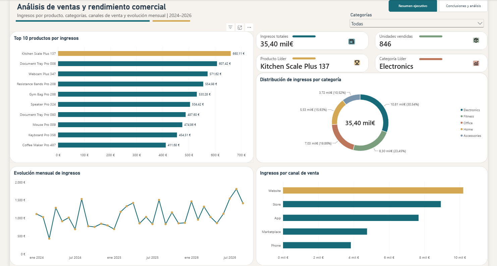
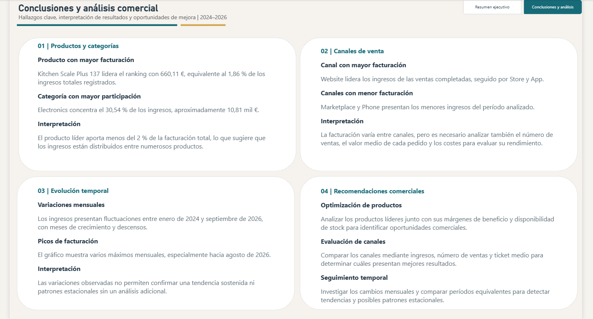

# 📊 Proyecto 10 | Análisis de ventas y rendimiento comercial

## 🎯 Objetivo del proyecto

Analizar los ingresos de ventas completadas entre enero de 2024 y septiembre de 2026, identificando los productos con mayor facturación, el rendimiento de las categorías, los canales de venta y la evolución mensual de ingresos.

El proyecto combina **MySQL, SQL, Power BI y DAX**, desde la preparación y validación de datos hasta la elaboración de un informe interactivo con conclusiones y recomendaciones comerciales.

---

## 🛠️ Herramientas utilizadas

- **MySQL Workbench:** consultas y validación de datos.
- **SQL:** INNER JOIN, SUM(), COUNT(), GROUP BY, ORDER BY, WHERE, HAVING y LIMIT.
- **Power BI Desktop:** modelado, visualización y creación de informes interactivos.
- **Power Query:** preparación de los datos importados.
- **DAX:** medidas dinámicas, indicadores KPI y cálculo de participación porcentual.

---

## 🗂️ Dataset y preparación de datos

Se utilizaron dos tablas de la base de datos `sql_powerbi_practice`:

| Tabla | Información |
|---|---|
| `sales_500` | Transacciones, cantidades, ingresos, fechas y canales de venta |
| `products_500` | Identificadores, nombres y categorías de productos |

Ambas tablas se relacionaron mediante `product_id`, utilizando `INNER JOIN`.

Se consideraron exclusivamente las ventas cuyo estado es `Completed`.

### Validación de integridad

Antes de importar los datos a Power BI se realizaron comprobaciones para verificar que la unión no duplicaba ni eliminaba registros de ventas completadas.

| Indicador | Tabla original | INNER JOIN |
|---|---:|---:|
| Ventas completadas | 433 | 433 |
| Ingresos totales | 35.399,80 € | 35.399,80 € |

**Resultado:** no se detectaron diferencias entre los registros ni los importes de las ventas completadas antes y después de la unión.

También se comprobó que `product_id` no presentaba duplicados en `products_500`.

---

## 💻 Consulta SQL | Top 10 productos por ingresos

```sql
SELECT
    p500.product_id,
    p500.product_name,
    p500.category,
    SUM(s500.quantity) AS unidades_vendidas,
    SUM(s500.revenue) AS ingreso_producto
FROM products_500 p500
INNER JOIN sales_500 s500
    ON p500.product_id = s500.product_id
WHERE s500.order_status = 'Completed'
GROUP BY
    p500.product_id,
    p500.product_name,
    p500.category
ORDER BY ingreso_producto DESC
LIMIT 10;
```

### Conceptos aplicados

1. `INNER JOIN`: relacionar productos con transacciones.
2. `WHERE`: seleccionar únicamente ventas completadas.
3. `SUM()`: calcular unidades vendidas e ingresos.
4. `GROUP BY`: agrupar los resultados por producto.
5. `ORDER BY DESC`: ordenar los productos por facturación.
6. `LIMIT 10`: obtener los diez productos con mayores ingresos.

---

## 📥 Consulta utilizada en Power BI

Para construir un dashboard interactivo se importaron las ventas completadas con sus detalles, sin aplicar `GROUP BY` ni `LIMIT 10`.

```sql
SELECT
    s500.sale_id,
    p500.product_id,
    p500.product_name,
    p500.category,
    s500.quantity,
    s500.revenue,
    s500.sale_date,
    s500.sales_channel
FROM sales_500 s500
INNER JOIN products_500 p500
    ON s500.product_id = p500.product_id
WHERE s500.order_status = 'Completed';
```

Esto permitió calcular rankings dinámicos y analizar todos los productos disponibles, incluso al filtrar por categoría.

---

## 📈 Informe Power BI | Dos páginas interactivas

### Página 1 | Resumen ejecutivo

El dashboard incluye:

- Ranking dinámico de los diez productos con mayores ingresos.
- Distribución porcentual de ingresos por categoría.
- Evolución mensual de ingresos entre 2024 y 2026.
- Comparación de ingresos por canal de venta.
- Segmentación interactiva por categoría.
- Cuatro tarjetas KPI: ingresos, unidades, producto líder y categoría líder.



### Página 2 | Conclusiones y análisis

Segunda página orientada a interpretar los resultados y comunicar posibles oportunidades de mejora.

Incluye:

- Productos y categorías destacados.
- Comparación de canales de venta.
- Interpretación de la evolución temporal.
- Recomendaciones para futuros análisis comerciales.

Ambas páginas están conectadas mediante botones de navegación.



---

## 🧮 Medidas DAX utilizadas

### 1. Producto líder

```dax
Producto Líder =
VAR RankingProductos =
    TOPN(
        1,
        ADDCOLUMNS(
            VALUES('Consulta'[product_name]),
            "IngresosProducto",
            CALCULATE(SUM('Consulta'[revenue]))
        ),
        [IngresosProducto], DESC,
        'Consulta'[product_name], ASC
    )
RETURN
    MAXX(RankingProductos, 'Consulta'[product_name])
```

Identifica el producto con mayor facturación dentro del contexto de filtros.

### 2. Categoría líder

```dax
Categoría Líder =
VAR RankingCategorias =
    TOPN(
        1,
        ADDCOLUMNS(
            VALUES('Consulta'[category]),
            "IngresosCategoria",
            CALCULATE(SUM('Consulta'[revenue]))
        ),
        [IngresosCategoria], DESC,
        'Consulta'[category], ASC
    )
RETURN
    MAXX(RankingCategorias, 'Consulta'[category])
```

Obtiene la categoría con mayores ingresos según los filtros seleccionados.

### 3. Participación porcentual en ingresos

```dax
% Participación Ingresos =
DIVIDE(
    SUM('Consulta'[revenue]),
    CALCULATE(
        SUM('Consulta'[revenue]),
        REMOVEFILTERS(
            'Consulta'[product_id],
            'Consulta'[product_name]
        )
    ),
    0
)
```

Permite calcular el porcentaje de ingresos que representa un producto respecto al total del contexto seleccionado, conservando los filtros de otras dimensiones.

La medida se incorporó a la información sobre herramientas del ranking de productos.

---

## 🔎 Principales resultados

| Indicador | Resultado |
|---|---:|
| Ventas completadas | 433 |
| Ingresos totales | 35.399,80 € |
| Unidades vendidas | 846 |
| Producto con mayor facturación | Kitchen Scale Plus 137 |
| Ingresos del producto líder | 660,11 € |
| Participación del producto líder | 1,86 % |
| Categoría líder | Electronics |
| Participación de Electronics | 30,54 % |
| Canal con mayores ingresos | Website |

### Distribución de ingresos por categoría

| Categoría | Ingresos aproximados | Participación |
|---|---:|---:|
| Electronics | 10,81 mil € | 30,54 % |
| Fitness | 8,30 mil € | 23,45 % |
| Office | 7,03 mil € | 19,86 % |
| Home | 5,53 mil € | 15,63 % |
| Accessories | 3,72 mil € | 10,52 % |

---

## 💡 Conclusiones del análisis

### 1. Productos y categorías

Kitchen Scale Plus 137 lidera la facturación individual con 660,11 €, equivalente al 1,86 % de los ingresos totales.

Electronics y Fitness representan conjuntamente el 53,99 % de los ingresos registrados.

### 2. Canales de venta

Website presenta la mayor facturación, seguido por Store y App.

No obstante, para evaluar la rentabilidad de cada canal sería necesario estudiar los costes, el número de transacciones y el ticket medio.

### 3. Evolución temporal

Los ingresos presentan variaciones mensuales entre enero de 2024 y septiembre de 2026.

Se observan máximos y descensos, pero no es posible confirmar una tendencia sostenida ni atribuir las fluctuaciones a causas específicas sin análisis adicional.

### 4. Recomendaciones comerciales

- Evaluar márgenes y disponibilidad de stock de los productos líderes.
- Analizar el ticket medio y el volumen de transacciones por canal.
- Investigar posibles patrones estacionales comparando períodos equivalentes.
- Profundizar en la distribución de ingresos entre productos y categorías.

---

## 🚀 Aprendizajes

Este proyecto permitió reforzar conocimientos en:

- Relaciones entre tablas mediante `INNER JOIN`.
- Validación de integridad y consistencia de datos.
- Agregaciones y rankings de productos en SQL.
- Importación de datos detallados para análisis dinámico.
- Medidas DAX dependientes del contexto de filtros.
- Visualizaciones comerciales e indicadores KPI.
- Comparación de ingresos por productos, categorías, canales y fechas.
- Navegación entre páginas en Power BI.
- Interpretación de resultados y comunicación de recomendaciones.

---

**Proyecto desarrollado como parte de mi portfolio de análisis de datos y Business Intelligence.**
