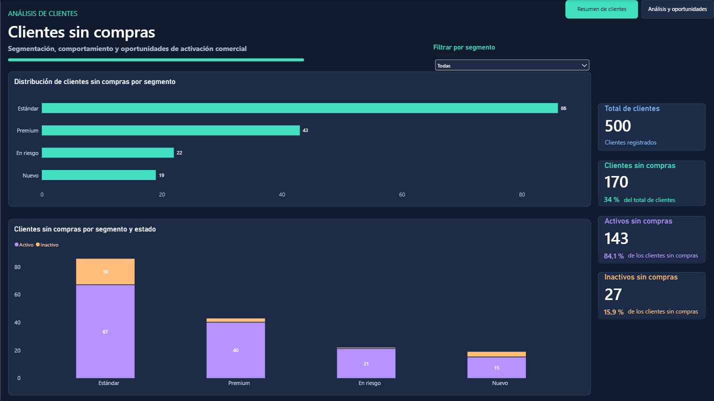
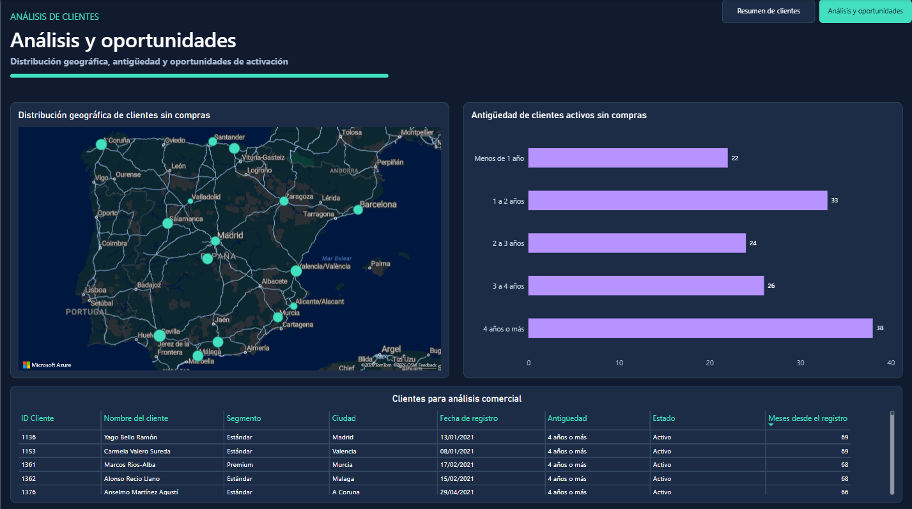

# 📊 Proyecto 11 | Análisis de clientes sin compras

## 🎯 Objetivo

Identificar los clientes que no tienen compras registradas y analizar sus características para detectar posibles oportunidades de activación comercial.

El proyecto combina **MySQL, SQL, Power BI y DAX**, desde la identificación y validación de registros hasta la construcción de un dashboard interactivo de dos páginas.

> **Nota:** Los datos utilizados son ficticios y se emplean exclusivamente con fines de aprendizaje y portfolio.

---

## 🛠️ Herramientas utilizadas

- **MySQL Workbench:** consultas y comprobación de resultados.
- **SQL:** LEFT JOIN, IS NULL, COUNT(), GROUP BY y ORDER BY.
- **Power BI Desktop:** análisis y visualización de datos.
- **Power Query:** transformación de datos y adaptación de etiquetas al español.
- **DAX:** indicadores dinámicos, porcentajes y clasificación de antigüedad.
- **Azure Maps:** representación geográfica de clientes por ciudad.

---

## 🗂️ Fuentes de datos

Base de datos: `sql_powerbi_practice`

| Tabla | Contenido |
|---|---|
| `customers_500` | Información general de los clientes |
| `sales_500` | Registros de ventas |

La relación entre ambas tablas se realizó mediante `customer_id`.

Para identificar a los clientes sin compras se utilizó un `LEFT JOIN`, conservando todos los clientes y buscando aquellos sin correspondencias en la tabla de ventas mediante `IS NULL`.

---

## 💻 Consulta SQL 1 | Clientes sin compras

```sql
SELECT
    c500.customer_id,
    c500.customer_name,
    c500.signup_date,
    c500.segment,
    c500.active_status,
    c500.city
FROM customers_500 c500
LEFT JOIN sales_500 s500
    ON c500.customer_id = s500.customer_id
WHERE s500.customer_id IS NULL;
```

**Resultado:** 170 clientes sin ninguna venta registrada.

Esta consulta permite recuperar los datos individuales necesarios para analizar segmentos, estados, ciudades y antigüedad desde el registro.

---

## 💻 Consulta SQL 2 | Análisis por segmento y estado

```sql
SELECT
    c500.segment,
    c500.active_status,
    COUNT(*) AS clientes_sin_compras
FROM customers_500 c500
LEFT JOIN sales_500 s500
    ON c500.customer_id = s500.customer_id
WHERE s500.customer_id IS NULL
GROUP BY
    c500.segment,
    c500.active_status
ORDER BY clientes_sin_compras DESC;
```

La suma de todos los grupos coincide con los 170 clientes identificados en la primera consulta.

### Resultados por segmento

| Segmento | Activos | Inactivos | Total |
|---|---:|---:|---:|
| Estándar | 67 | 19 | 86 |
| Premium | 40 | 3 | 43 |
| En riesgo | 21 | 1 | 22 |
| Nuevo | 15 | 4 | 19 |
| **Total** | **143** | **27** | **170** |

Los nombres de los segmentos se adaptaron al español en Power Query para facilitar la lectura del informe.

---

## 📈 Dashboard Power BI

### Página 1 | Resumen de clientes

Informe ejecutivo con:

- Total de clientes registrados.
- Clientes sin compras y porcentaje sobre el total.
- Clientes activos e inactivos sin compras.
- Distribución de clientes sin compras por segmento.
- Comparación de estados por segmento.
- Segmentador interactivo por tipo de cliente.



### Página 2 | Análisis y oportunidades

Análisis complementario con:

- Mapa de España con marcadores geográficos mediante Azure Maps.
- Distribución por antigüedad de clientes activos sin compras.
- Tabla detallada de clientes activos sin compras.
- Ordenación por meses transcurridos desde el registro.
- Navegación interactiva entre ambas páginas.



---

## 🧮 Medidas DAX

### Total de clientes

```dax
Total Clientes =
DISTINCTCOUNT('Todos_los_clientes'[customer_id])
```

### Clientes sin compras

```dax
Clientes Sin Compras =
DISTINCTCOUNT('Clientes_sin_compras'[customer_id])
```

### Porcentaje de clientes sin compras

```dax
% Clientes Sin Compras =
DIVIDE(
    [Clientes Sin Compras],
    [Total Clientes],
    0
)
```

### Clientes activos sin compras

```dax
Clientes Activos Sin Compras =
CALCULATE(
    DISTINCTCOUNT('Clientes_sin_compras'[customer_id]),
    'Clientes_sin_compras'[active_status] = "Activo"
)
```

### Clientes inactivos sin compras

```dax
Clientes Inactivos Sin Compras =
CALCULATE(
    DISTINCTCOUNT('Clientes_sin_compras'[customer_id]),
    'Clientes_sin_compras'[active_status] = "Inactivo"
)
```

### Porcentajes por estado

```dax
% Activos Sin Compras =
DIVIDE(
    [Clientes Activos Sin Compras],
    [Clientes Sin Compras],
    0
)
```

```dax
% Inactivos Sin Compras =
DIVIDE(
    [Clientes Inactivos Sin Compras],
    [Clientes Sin Compras],
    0
)
```

Estas medidas permiten calcular indicadores que responden al contexto de filtros del informe.

---

## 📅 Análisis de antigüedad

Se crearon columnas calculadas para clasificar a los clientes según el tiempo transcurrido desde su registro.

### Meses desde el registro

```dax
Meses desde registro =
DATEDIFF(
    'Clientes_sin_compras'[signup_date],
    TODAY(),
    MONTH
)
```

### Clasificación de antigüedad

```dax
Rango Antigüedad =
SWITCH(
    TRUE(),
    'Clientes_sin_compras'[Meses desde registro] < 12, "Menos de 1 año",
    'Clientes_sin_compras'[Meses desde registro] < 24, "1 a 2 años",
    'Clientes_sin_compras'[Meses desde registro] < 36, "2 a 3 años",
    'Clientes_sin_compras'[Meses desde registro] < 48, "3 a 4 años",
    "4 años o más"
)
```

Se creó una columna adicional de orden numérico basada en los meses para mostrar los rangos cronológicamente y evitar dependencias circulares.

**Nota:** DATEDIFF con MONTH cuenta límites de mes. Por tanto, los intervalos representan una aproximación de antigüedad y se recalculan al actualizar el modelo.

---

## 📊 Principales resultados

| Indicador | Resultado |
|---|---:|
| Clientes registrados | 500 |
| Clientes sin compras | 170 |
| Porcentaje sin compras | 34 % |
| Clientes activos sin compras | 143 |
| Clientes inactivos sin compras | 27 |
| Segmento con más clientes sin compras | Estándar (86) |
| Ciudad con más clientes sin compras | Sevilla (18) |
| Activos sin compras con 4 años o más de antigüedad | 38 |

### Antigüedad de clientes activos sin compras

| Antigüedad | Clientes |
|---|---:|
| Menos de 1 año | 22 |
| 1 a 2 años | 33 |
| 2 a 3 años | 24 |
| 3 a 4 años | 26 |
| 4 años o más | 38 |
| **Total** | **143** |

---

## 💡 Conclusiones comerciales

### 1. Clientes sin compras

El 34 % de los clientes registrados no presenta ventas asociadas en el conjunto de datos analizado.

Este resultado invita a investigar posibles barreras de conversión antes de proponer acciones comerciales.

### 2. Clientes activos

De los 170 clientes sin compras, 143 figuran como activos.

Este grupo constituye una población inicial para estudiar oportunidades de primera compra, aunque el estado activo no garantiza intención de compra.

### 3. Antigüedad del registro

38 clientes activos sin compras se encuentran en el grupo de cuatro años o más desde el registro.

Sería conveniente analizar si existen problemas de comunicación, adquisición o experiencia del cliente que expliquen la ausencia de compras.

### 4. Distribución comercial y geográfica

El segmento Estándar reúne 86 clientes sin compras y Sevilla es la ciudad con mayor recuento individual, con 18.

Para establecer prioridades comerciales sería necesario comparar estos resultados con la distribución total de clientes por segmento y ciudad.

---

## 🚀 Aprendizajes del proyecto

Este proyecto permitió practicar:

- Identificación de registros sin correspondencia mediante LEFT JOIN e IS NULL.
- Consultas SQL de detalle y agregación.
- Validación de recuentos entre consultas.
- Importación de varias consultas desde MySQL a Power BI.
- Transformaciones de datos en Power Query.
- Creación y comprensión de medidas DAX.
- Clasificación y ordenación de rangos de antigüedad.
- Visualizaciones geográficas mediante Azure Maps.
- Segmentadores, filtros y navegación entre páginas.
- Interpretación de resultados y formulación de hipótesis comerciales.

Las medidas DAX se desarrollaron con apoyo de inteligencia artificial como parte del proceso de aprendizaje.

---

**Proyecto práctico desarrollado para mi portfolio de Análisis de Datos y Business Intelligence.**
