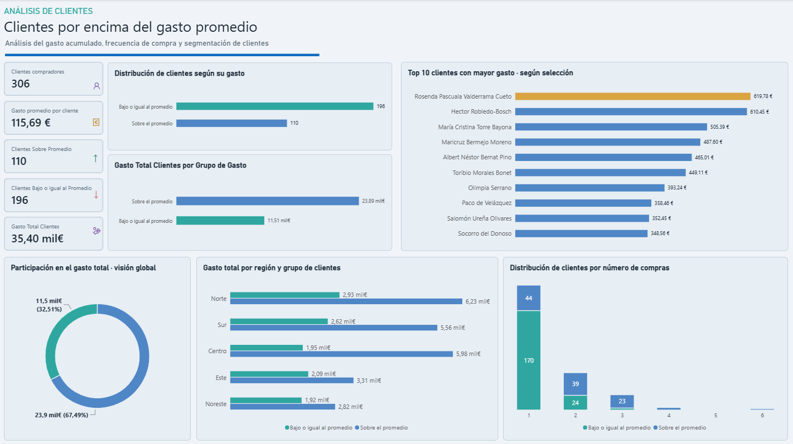

# 📊 Proyecto 13 | Clientes por encima del gasto promedio

### SQL · MySQL · Power BI · DAX · Power Query

## 🎯 Objetivo del proyecto

Analizar el comportamiento de compra de los clientes de una empresa de comercio electrónico para identificar aquellos cuyo gasto acumulado supera el promedio general.

El análisis busca responder preguntas como:

- ¿Cuántos clientes superan el gasto promedio?
- ¿Qué proporción del gasto total generan?
- ¿Qué relación existe entre frecuencia de compra y gasto?
- ¿Qué clientes concentran los mayores importes?
- ¿Cómo se distribuye el gasto por región?

El proyecto combina **consultas SQL con CTE y subconsultas** y un **dashboard interactivo en Power BI** para facilitar la interpretación de los resultados.

> **Nota:** Los datos son ficticios y se utilizan con fines educativos y de portfolio.

---

## 🛠️ Herramientas utilizadas

- **MySQL Workbench:** consultas SQL, agregaciones y validación de resultados.
- **SQL:** INNER JOIN, SUM(), COUNT(), AVG(), GROUP BY, WITH (CTE) y subconsultas.
- **Power Query:** importación de la consulta SQL, revisión y preparación de datos.
- **Power BI:** indicadores KPI, visualizaciones, segmentación e interacciones.
- **DAX:** medidas, columnas calculadas, contexto de filtros y formato condicional dinámico.

---

## 🗂️ Fuente de datos

Base de datos: `sql_powerbi_practice`

Tablas utilizadas:

- `sales_500`: registros de ventas, importes, cantidades y estados de pedidos.
- `customers_500`: información de clientes, nombres, regiones y estado de actividad.

### Criterios del análisis

Se incluyeron únicamente las ventas con estado `Completed`, excluyendo las canceladas y devueltas.

Se consideraron clientes activos e inactivos, siempre que tuvieran al menos una compra completada.

Por tanto, el gasto promedio se calcula sobre **306 clientes compradores**, no sobre todos los clientes registrados en la base de datos.

---

## 💻 Análisis SQL

### Ejercicio 11. Clientes por encima del gasto promedio

El ejercicio consistió en crear una CTE que calculara el gasto total y el número de compras por cliente, para después identificar mediante una subconsulta a quienes superaban el promedio general.

```sql
WITH gastos_clientes AS (
    SELECT
        c500.customer_id,
        c500.customer_name,
        SUM(s500.revenue) AS gasto_total,
        COUNT(s500.sale_id) AS numero_compras
    FROM sales_500 AS s500
    INNER JOIN customers_500 AS c500
        ON s500.customer_id = c500.customer_id
    WHERE s500.order_status = 'Completed'
    GROUP BY
        c500.customer_id,
        c500.customer_name
)
SELECT *
FROM gastos_clientes
WHERE gasto_total > (
    SELECT AVG(gasto_total)
    FROM gastos_clientes
)
ORDER BY gasto_total DESC;
```

### ¿Cómo funciona?

**1. CTE (`WITH`)**

Agrupa las compras completadas por cliente y calcula el gasto acumulado y la cantidad de compras.

**2. Subconsulta (`SELECT AVG(...)`)**

Calcula el promedio de los gastos acumulados que devuelve la CTE.

**3. Consulta principal (`WHERE`)**

Selecciona únicamente los clientes cuyo gasto total supera ese promedio.

### Preparación para Power BI

Para desarrollar el dashboard se reutilizó la CTE sin limitar el resultado a los clientes de mayor gasto.

También se incorporó la región desde `customers_500`, permitiendo comparar ambos grupos y estudiar su distribución geográfica.

El conjunto importado contiene **306 filas**, una por cliente con compras completadas.

---

## 🧮 Análisis DAX

En Power BI se crearon indicadores dinámicos a partir de los resultados obtenidos con SQL.

### Clientes compradores

```dax
Clientes compradores =
DISTINCTCOUNT(
    'Análisis del gasto de clientes'[customer_id]
)
```

### Gasto promedio por cliente

```dax
Gasto promedio por cliente =
AVERAGE(
    'Análisis del gasto de clientes'[gasto_total]
)
```

### Gasto total de clientes

```dax
Gasto Total Clientes =
SUM(
    'Análisis del gasto de clientes'[gasto_total]
)
```

### Clasificación de clientes

Se creó una columna calculada para distinguir dos grupos utilizando como referencia el promedio general validado en SQL.

```dax
Grupo de Gasto =
IF(
    'Análisis del gasto de clientes'[gasto_total] > 115.69,
    "Sobre el promedio",
    "Bajo o igual al promedio"
)
```

Esta clasificación utiliza un umbral fijo y no cambia al seleccionar filtros en el dashboard.

### Clientes sobre el promedio

```dax
Clientes Sobre Promedio =
COALESCE(
    CALCULATE(
        [Clientes compradores],
        KEEPFILTERS(
            'Análisis del gasto de clientes'[Grupo de Gasto]
                = "Sobre el promedio"
        )
    ),
    0
)
```

### Clientes bajo o igual al promedio

```dax
Clientes Bajo o Igual al Promedio =
COALESCE(
    CALCULATE(
        [Clientes compradores],
        KEEPFILTERS(
            'Análisis del gasto de clientes'[Grupo de Gasto]
                = "Bajo o igual al promedio"
        )
    ),
    0
)
```

**Aprendizaje destacado:** KEEPFILTERS() permite conservar los filtros existentes y combinar condiciones, mientras que COALESCE() permite mostrar cero cuando una medida devuelve un valor vacío.

También se implementó una medida de formato condicional para destacar en dorado al cliente con mayor gasto dentro de la selección actual.

---

## 📈 Dashboard interactivo

El informe de Power BI contiene:

- Cinco indicadores KPI.
- Distribución de clientes por nivel de gasto.
- Comparación del gasto total entre grupos.
- Top 10 dinámico de clientes con mayor gasto.
- Frecuencia de compra según el grupo de clientes.
- Distribución del gasto total por región.
- Gráfico de anillos con la participación global del gasto.
- Interacciones entre visualizaciones.
- Formato condicional dinámico para destacar al cliente con mayor gasto.

### Vista general del dashboard



📥 [Descargar dashboard interactivo de Power BI](EJERCICIO11.Clientes_por_encima_del_gasto_promedio.pbix)

---

## 📊 Resultados principales

| Indicador | Resultado |
|---|---:|
| Clientes con compras completadas | 306 |
| Gasto total registrado | 35,40 mil € |
| Gasto promedio por cliente | 115,69 € |
| Clientes sobre el promedio | 110 |
| Clientes bajo o igual al promedio | 196 |
| Porcentaje de clientes sobre el promedio | 35,9 % |
| Participación del grupo superior en el gasto total | 67,49 % |
| Clientes con una sola compra | 214 |
| Clientes con una compra y gasto superior al promedio | 44 |

### Participación en el gasto total

| Grupo | Clientes | Gasto aproximado | Participación |
|---|---:|---:|---:|
| Sobre el promedio | 110 | 23,89 mil € | 67,49 % |
| Bajo o igual al promedio | 196 | 11,51 mil € | 32,51 % |

---

## 💡 Principales hallazgos

### 1. Concentración del gasto

El **35,9 % de los clientes genera aproximadamente el 67,5 % del gasto total**.

Esto revela una distribución desigual del gasto y permite identificar un segmento relevante para posibles estrategias de fidelización.

### 2. Predominio de clientes con una sola compra

De los 306 clientes analizados, **214 realizaron una única compra completada**.

Esto equivale aproximadamente al 69,9 % del conjunto de compradores.

La frecuencia de compra resulta, por tanto, una dimensión relevante para complementar el análisis del gasto.

### 3. Clientes de alto gasto con baja frecuencia

Dentro de los 110 clientes que superan el promedio, **44 realizaron una sola compra**.

Estos clientes destacan por el importe de su compra, pero no presentan recurrencia en los registros analizados.

Podrían ser un segmento de interés para estudiar acciones de segunda compra, previa revisión de la fecha de su primera transacción.

### 4. Diferencias entre regiones

La región **Norte** presenta el mayor gasto total registrado.

El análisis también muestra diferencias en la aportación de los clientes de mayor gasto entre regiones, lo que permite explorar posibles estrategias comerciales segmentadas.

### 5. Importancia de los filtros y el contexto de evaluación

Los indicadores cambian cuando se seleccionan grupos o regiones.

Por ejemplo, el gasto promedio del conjunto completo es de 115,69 €, pero aumenta a aproximadamente 217,21 € cuando se analiza exclusivamente el grupo que supera el promedio.

Este comportamiento demuestra la importancia de distinguir entre un **umbral de clasificación fijo** y una **medida dinámica evaluada bajo filtros**.

---

## 🚀 Aprendizajes del proyecto

- Construcción de CTE mediante WITH.
- Uso de subconsultas con funciones de agregación.
- Cálculo del gasto promedio sobre resultados previamente agrupados.
- Integración de tablas mediante INNER JOIN.
- Diferencia entre número de compras y unidades vendidas.
- Importación de resultados SQL a Power BI.
- Creación de medidas y columnas calculadas en DAX.
- Uso de CALCULATE(), FILTER(), KEEPFILTERS() y COALESCE().
- Comprensión del contexto de filtros.
- Configuración de interacciones entre gráficos.
- Creación de rankings dinámicos y formato condicional.
- Interpretación de concentración del gasto, frecuencia de compra y diferencias regionales.

---

## 📌 Limitaciones del análisis

Los resultados describen únicamente las compras completadas registradas en el conjunto de datos.

El gasto acumulado no equivale necesariamente a rentabilidad o valor de vida del cliente.

Para realizar recomendaciones comerciales más precisas sería conveniente incorporar información sobre fechas de compra, márgenes, devoluciones, captación y comportamiento posterior.

---

## 🎯 Conclusión

Este proyecto demuestra cómo combinar **SQL y Power BI** para pasar de una consulta técnica a un análisis de comportamiento de clientes.

La utilización de CTE, subconsultas y medidas DAX permite identificar segmentos, comparar resultados y construir visualizaciones útiles para interpretar información comercial.

**Proyecto práctico desarrollado como parte de mi portfolio de Data Analytics y Business Intelligence.**
