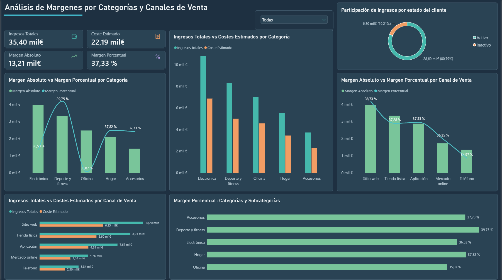

# 📊 Proyecto 14 | Análisis de Márgenes por Categorías y Canales de Venta

### SQL · MySQL · Power BI · DAX · Power Query

## 🎯 Objetivo del proyecto

Analizar los ingresos, costes estimados y márgenes comerciales de una empresa, identificando las categorías de productos y los canales de venta que presentan mejores resultados.

El objetivo es responder preguntas como:

- ¿Qué categorías generan más ingresos y margen absoluto?
- ¿Cuáles presentan el mayor margen porcentual?
- ¿Qué canales de venta aportan más margen económico?
- ¿Cómo varía la rentabilidad entre categorías y subcategorías?
- ¿Qué proporción de los ingresos procede de clientes activos e inactivos?

El proyecto combina consultas SQL, modelado de datos y visualizaciones interactivas en Power BI.

> **Nota:** Proyecto educativo desarrollado con datos ficticios.

---

## 🛠️ Herramientas utilizadas

- **MySQL Workbench:** extracción, consultas y validación de datos.
- **SQL:** INNER JOIN, SUM(), COUNT(), GROUP BY, ORDER BY, ROUND() y NULLIF().
- **Power Query:** importación, limpieza y traducción de categorías, canales y subcategorías.
- **Power BI:** dashboard interactivo, indicadores KPI y análisis comercial.
- **DAX:** SUMX(), SUM(), DIVIDE() y medidas dinámicas.
- **Modelado de datos:** relaciones entre tablas y tabla auxiliar de traducciones.

---

## 🗂️ Fuente de datos

Se utilizaron tres tablas de la base de datos `sql_powerbi_practice`:

| Tabla | Información |
|---|---|
| `sales_500` | Ventas, ingresos, cantidades, canales y estados de pedidos |
| `products_500` | Productos, categorías, subcategorías y costes unitarios |
| `customers_500` | Clientes y estado de actividad |

Se incluyeron únicamente las ventas con estado `Completed`.

**Conjunto final: 433 registros de ventas completadas**, sin duplicados de `sale_id` tras realizar los JOIN.

---

## 💻 Desarrollo del análisis SQL

El análisis comenzó calculando los siguientes indicadores por categoría:

- Ingresos totales.
- Coste estimado: cantidad vendida × coste unitario.
- Margen absoluto: ingresos menos coste estimado.
- Margen porcentual: margen absoluto dividido entre ingresos.

Posteriormente, se ampliaron las consultas para analizar:

1. Rentabilidad por categoría: comparación de ingresos, costes y márgenes entre las principales familias de productos.

2. Análisis detallado por subcategoría y canal: identificación de diferencias de rentabilidad según el tipo de producto y el canal utilizado.

3. Rendimiento global por canal de venta: clasificación de los canales según su margen absoluto y porcentual.

4. Rentabilidad de clientes activos: evaluación de los márgenes por canal considerando únicamente las ventas completadas de clientes actualmente activos.

Se utilizaron `INNER JOIN` para relacionar las tablas y `NULLIF()` para evitar divisiones entre cero.

### Preparación de la consulta para Power BI

Para construir el dashboard se importó el detalle de las ventas completadas, sin agrupar previamente los resultados.

Esto permitió calcular los indicadores mediante medidas DAX y mantener la interactividad de los filtros.

---

## 🧮 Medidas DAX

### Coste estimado

```dax
Coste Estimado =
SUMX(
    Analisis_Margenes,
    Analisis_Margenes[quantity] * Analisis_Margenes[unit_cost]
)
```

`SUMX()` calcula el coste estimado de cada registro y suma los resultados.

### Margen absoluto

```dax
Margen Absoluto =
SUM(Analisis_Margenes[revenue]) - [Coste Estimado]
```

### Margen porcentual

```dax
Margen Porcentual =
DIVIDE(
    [Margen Absoluto],
    SUM(Analisis_Margenes[revenue]),
    0
)
```

La medida de margen porcentual se presenta con formato de porcentaje y dos decimales.

Las medidas responden dinámicamente a los filtros por categoría, canal y estado del cliente.

---

## 📈 Dashboard interactivo en Power BI

El dashboard incluye:

- Cuatro KPI principales: ingresos, costes, margen absoluto y margen porcentual.
- Comparación de ingresos y costes por categoría.
- Comparación de ingresos y costes por canal.
- Gráficos combinados de margen absoluto y porcentual.
- Jerarquía interactiva de categorías y subcategorías.
- Participación de ingresos según el estado del cliente.
- Segmentador de categorías.
- Traducción de los canales, categorías y 40 subcategorías al español.

Se utilizó una paleta visual oscura denominada **Midnight Teal**, con colores diferenciados para ingresos, costes y márgenes.

### Vista del dashboard



---

## 📊 Resultados principales

| Indicador | Resultado |
|---|---:|
| Ventas completadas analizadas | 433 |
| Ingresos totales | 35.400,80 € |
| Coste estimado | 22.188,36 € |
| Margen absoluto estimado | 13.212,44 € |
| Margen porcentual | 37,33 % |

### Margen por categoría

| Categoría | Margen absoluto | Margen porcentual |
|---|---:|---:|
| Electrónica | 3.949,16 € | 36,53 % |
| Deporte y fitness | 3.299,96 € | 39,75 % |
| Oficina | 2.465,70 € | 35,07 % |
| Hogar | 2.093,07 € | 37,82 % |
| Accesorios | 1.405,25 € | 37,73 % |

### Margen por canal de venta

| Canal | Margen absoluto | Margen porcentual |
|---|---:|---:|
| Sitio web | 3.950,69 € | 38,73 % |
| Tienda física | 3.329,81 € | 37,28 % |
| Aplicación | 2.865,68 € | 37,35 % |
| Mercado online | 1.724,15 € | 36,25 % |
| Teléfono | 1.342,81 € | 34,97 % |

---

## 💡 Principales hallazgos

### 1. La categoría con mayores ingresos no es la más rentable porcentualmente

Electrónica registra los mayores ingresos y el mayor margen absoluto estimado.

Sin embargo, **Deporte y fitness presenta el mayor margen porcentual, con un 39,75 %**.

Esto demuestra la importancia de analizar tanto la aportación económica como la eficiencia del margen.

### 2. El sitio web lidera el rendimiento por canal

El canal Sitio web presenta:

- Los mayores ingresos: 10.200,21 €.
- El mayor margen absoluto: 3.950,69 €.
- El mayor margen porcentual: 38,73 %.

### 3. Los canales pueden cambiar de posición según el indicador

Tienda física supera a Aplicación en margen absoluto, pero Aplicación presenta un margen porcentual ligeramente superior.

Por tanto, clasificar los canales utilizando exclusivamente un indicador puede ofrecer una visión incompleta de su rendimiento.

### 4. Los clientes activos concentran la mayor parte de los ingresos

El **80,79 % de los ingresos registrados** corresponde a ventas completadas de clientes actualmente activos.

Se trata de una clasificación basada en su estado registrado, que no necesariamente coincide con el estado del cliente cuando realizó la compra.

### 5. Las subcategorías presentan diferencias relevantes

El análisis detallado permite identificar productos con márgenes porcentuales elevados y otros con resultados inferiores dentro de una misma categoría.

Esto puede servir como punto de partida para investigar precios, descuentos, costes y combinación de productos vendidos.

---

## 🎯 Aprendizajes

Este proyecto permitió reforzar competencias en:

- Integración de tres tablas mediante INNER JOIN.
- Agregación y segmentación de información comercial.
- Cálculo de márgenes absolutos y porcentuales.
- Validación de duplicados y calidad de datos.
- Creación de medidas DAX con SUMX() y DIVIDE().
- Diferenciación entre medidas y columnas.
- Configuración de filtros y jerarquías interactivas.
- Uso de relaciones entre tablas auxiliares.
- Traducción de valores mediante Power Query y tablas de equivalencias.
- Interpretación de indicadores orientados a Pricing Analytics.

---

## ⚠️ Limitaciones

Los márgenes calculados son estimaciones basadas en los ingresos y el coste unitario de los productos.

No se incluyen necesariamente gastos logísticos, marketing, comisiones, impuestos u otros costes operativos.

Por ello, **el margen estimado no debe interpretarse como beneficio neto**.

Para realizar recomendaciones de precios sería necesario complementar el análisis con información sobre demanda, competencia, elasticidad, descuentos y costes adicionales.

---

## 🚀 Conclusión

El Proyecto 14 demuestra cómo integrar **SQL, Power Query, Power BI y DAX** para analizar la rentabilidad comercial desde distintas perspectivas.

La comparación entre ingresos, costes, margen absoluto y margen porcentual permite identificar diferencias entre categorías, canales y segmentos de clientes, convirtiendo los datos en información útil para la toma de decisiones.

**Proyecto desarrollado como parte de mi portfolio de Data Analytics y Business Intelligence.**
