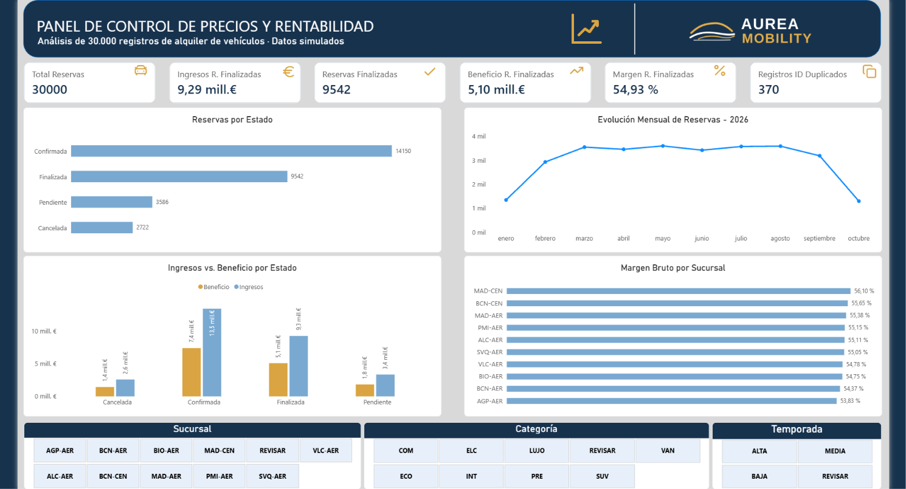
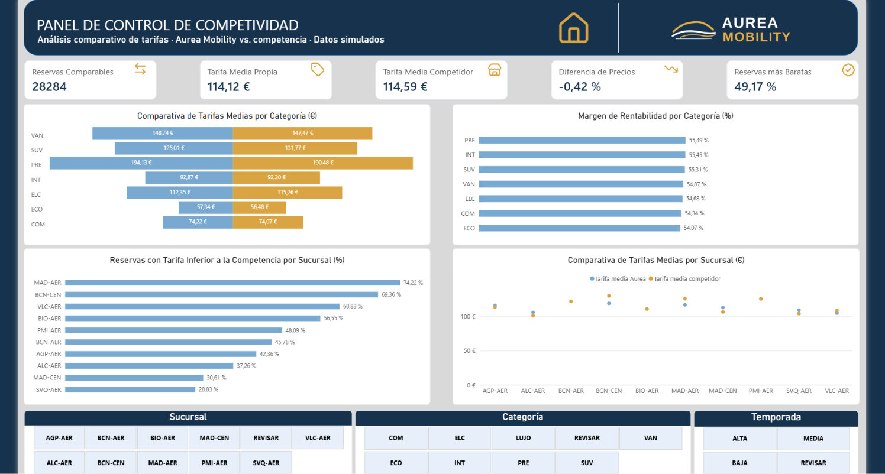
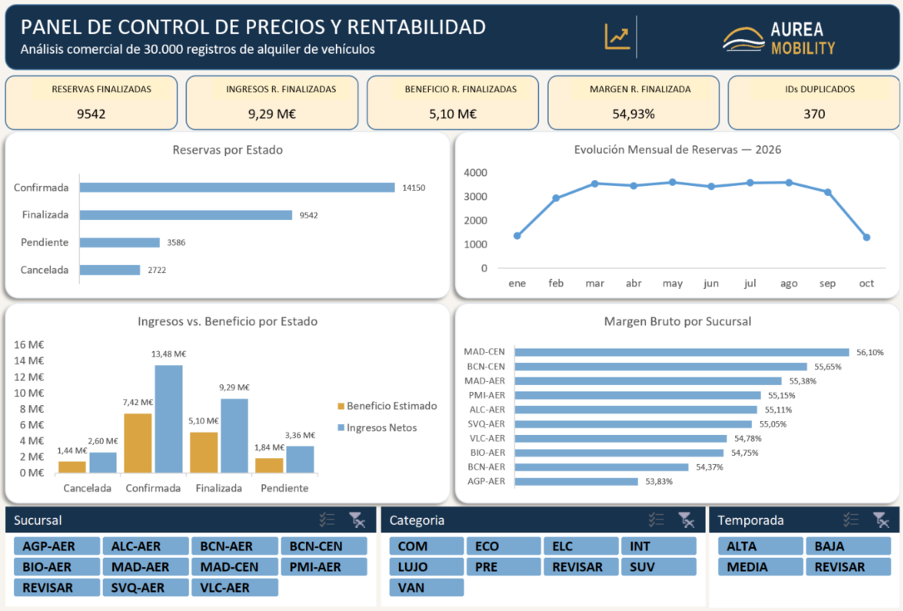
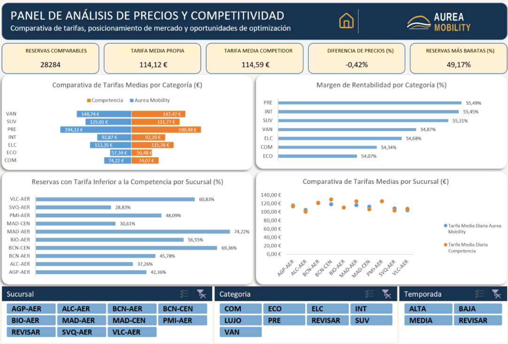

# Proyecto 15 | Car Rental Pricing & Profitability Analysis

**Análisis de precios, rentabilidad y competitividad en el alquiler de vehículos**  
**Herramientas:** Excel avanzado · Power BI · MySQL (fase futura)  
**Datos:** 30.000 registros simulados · Marca ficticia: Aurea Mobility

> **Estado del proyecto (noviembre de 2026):** disponibles dashboards de Excel y Power BI. La fase de limpieza, cálculo y análisis en MySQL se incorporará posteriormente. Los resultados que siguen son los que muestran los dashboards; no representan operaciones reales.

## 1. Objetivo

Desarrollar un caso práctico de *Pricing Analytics* que permita explorar:

- El volumen y la distribución de reservas por estado y por mes.
- Los ingresos, el beneficio bruto estimado y el margen según el estado y la sucursal.
- Las diferencias entre las tarifas propias y las de la competencia.
- Las categorías y sucursales donde podrían existir oportunidades de revisión de precios.
- La calidad de los datos y las incidencias que pueden afectar a la interpretación.

## 2. Indicadores destacados

| Indicador | Resultado mostrado |
|---|---:|
| Registros de reservas | 30.000 |
| Reservas finalizadas | 9.542 |
| Ingresos de reservas finalizadas | 9,29 M€ |
| Beneficio de reservas finalizadas | 5,10 M€ |
| Margen de reservas finalizadas | 54,93 % |
| Registros identificados con ID duplicado | 370 |
| Reservas comparables con la competencia | 28.284 |
| Tarifa media propia | 114,12 € |
| Tarifa media de la competencia | 114,59 € |
| Diferencia de precios | −0,42 % |
| Reservas con tarifa inferior a la competencia | 49,17 % |

**Interpretación:** las tarifas medias propias se sitúan ligeramente por debajo de las del competidor en el conjunto comparable representado. Esto **no** implica que todas las categorías o sucursales tengan el mismo posicionamiento; el análisis segmentado es fundamental.

**Nota de calidad:** los 370 registros señalados por el indicador de ID duplicado requieren revisión. La presencia de un identificador repetido no demuestra, por sí sola, que deba eliminarse una reserva.

## 3. Trabajo realizado

### Excel avanzado

- Preparación de tablas y análisis de registros simulados.
- Revisión de categorías, sucursales y temporadas, incluyendo campos corregidos para evitar perder el valor original.
- Relación de combinaciones categoría–sucursal–temporada con una tabla de tarifas; uso de búsquedas con **ÍNDICE + COINCIDIR** (*INDEX + MATCH*) cuando no está disponible BUSCARX.
- Cálculos comerciales y visualización mediante gráficos, tarjetas KPI y segmentadores.
- Construcción de dos paneles: **Precios y rentabilidad** y **Precios y competitividad**.

### Power BI

- Construcción de dos informes correspondientes a **Precios y rentabilidad** y **Competitividad**.
- Indicadores de reservas, ingresos, beneficio, margen, tarifas y posicionamiento frente a la competencia.
- Visualización por estado, mes, sucursal y categoría.
- Segmentadores para facilitar la exploración de los resultados.

### MySQL — por incorporar

La siguiente fase consistirá en importar las tablas, auditar y limpiar los datos, validar relaciones y reproducir los cálculos relevantes mediante SQL. **Los scripts aún no forman parte de esta versión.**

## 4. Capturas de los dashboards

### Power BI: precios y rentabilidad



### Power BI: competitividad



### Excel: precios y rentabilidad



### Excel: competitividad



## 5. Estructura del proyecto

```text
15-car-rental-pricing-analysis/
├── README.md
├── screenshots/
│   ├── powerbi-precios-rentabilidad.png
│   ├── powerbi-competitividad.png
│   ├── excel-precios-rentabilidad.png
│   └── excel-competitividad.png
├── excel/        # Se añadirá el libro .xlsx
├── powerbi/      # Se añadirá el informe .pbix
└── sql/          # Scripts MySQL pendientes
```

## 6. Consideraciones analíticas

- Todos los datos son **simulados**; las conclusiones son ilustrativas y no describen el rendimiento de una empresa real.
- Los KPI deben interpretarse de acuerdo con sus filtros y denominadores. Por ejemplo, las métricas de reservas **finalizadas** no deben confundirse con el total de los registros.
- Los importes asociados a reservas **confirmadas, pendientes o canceladas** en los gráficos requieren distinguir entre valores proyectados/estimados y resultados realizados antes de extraer conclusiones financieras.
- Los valores de categoría, sucursal o temporada pendientes de revisión no deberían corregirse por suposición.
- No se publicarán datos personales, credenciales ni conexiones privadas en el repositorio.

## 7. Próximos pasos

- [ ] Incorporar el libro de Excel utilizado para el análisis.
- [ ] Incorporar el archivo de Power BI (`.pbix`).
- [ ] Realizar controles de coherencia entre Excel y Power BI.
- [ ] Importar y trabajar las tablas en MySQL.
- [ ] Documentar los scripts SQL y las validaciones efectuadas.

---

**Portfolio de Data Analytics** · Proyecto 15 · Excel · Power BI · Pricing Analytics  
**Autor:** Tomislav Šalvarica
